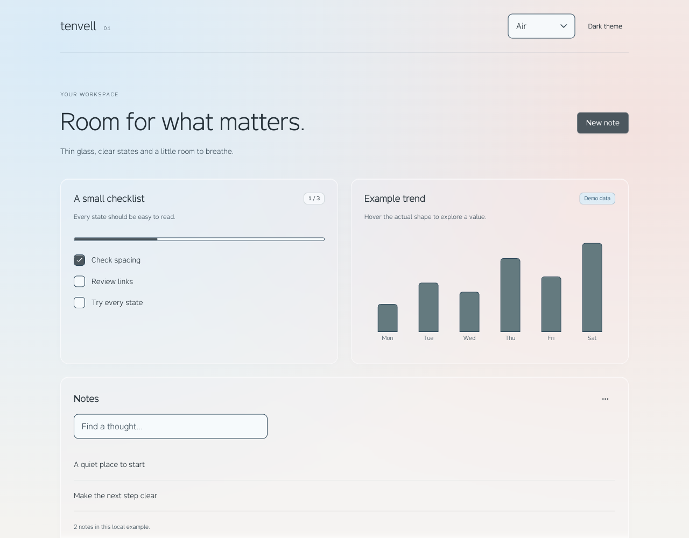

# tenvell

Thin glass. Clear interfaces.

[Live demo](https://tenvell.esher1.chatgpt.site/) · [Install](https://tenvell.esher1.chatgpt.site/install) · [GitHub](https://github.com/raven-ai-esh/tenvell)

An independent UI kit for React19: thin glass surfaces, readable controls, original Lamina typefaces and a restrained tactile response. The website contains83 live component examples plus a16-tile showcase, messenger, dashboard and draggable task-board demonstrations.

## Start the website

    npm ci
    npm run release:build
    npm run dev -- --port 4187

Open http://localhost:4187/. Installation instructions and downloadable artifacts live at /install.

## Rebuild the release

    npm run release:build
    npm run build
    node --test tests/*.test.mjs

The release build generates the core npm archive, source-first shadcn registry, starter and public manifest. It reads the current components, tokens and motion source; generated outputs are not a separate design implementation. Root package.json stays private so the website cannot be accidentally published as the core package.

Official Site and repository URLs are declared in release/project.json. Set TENVELL_SITE_URL when rebuilding for a different public origin. The source export removes the original Sites project_id so a fork does not share the hosted Site identity. No npm publication is implied; the core is installed from the Site archive or registry.

The release/output folder is generated. Public endpoints are /r/registry.json, /r/tenvell.json and /releases/0.1.1/manifest.json. The npm tarball contains its own exports, types, editable sources, scoped CSS and licences. /releases/0.1.1/tenvell-starter-0.1.1.zip contains a runnable locked starter with the tarball included. See release/docs/PACKAGE-README.md for the core API and initial export scope.

## Existing examples

The website examples use fictional local data. Message/task changes remain in the current view; the six preview settings alone can persist within the browser tab session. The source website includes calendar/table/toast and full-screen demonstrations beyond the first portable core API. Lamina UI/Mono are the original typeface family names.

## Licence

Own code: MIT (LICENSE). Original Lamina font software: SIL OFL1.1 (FONT-LICENSE.txt). Third-party libraries retain their own licences; see THIRD-PARTY-NOTICES.md and installed packages. This source release contains no service credentials, private evidence folders or unrelated project files.
