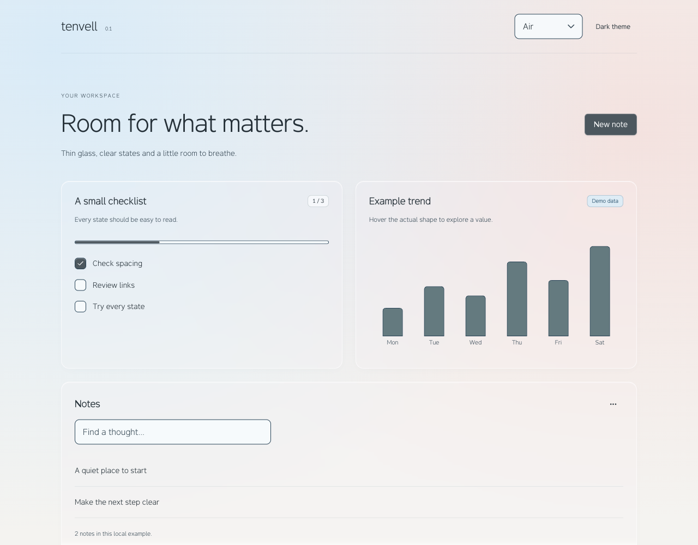

# tenvell

Thin glass. Clear interfaces.

[Live demo](https://tenvell.space/) · [First component](https://tenvell.space/install?lang=en#first-component) · [Install](https://tenvell.space/install) · [GitHub](https://github.com/raven-ai-esh/tenvell)



An independent UI kit for React19: thin glass surfaces, readable controls, original Lamina typefaces and a restrained tactile response. The website contains83 live component examples plus a16-tile showcase, messenger, dashboard and draggable task-board demonstrations.

## Website languages

The live catalog, installation guide and product examples support English and Russian. Use the EN/RU control in the shared toolbar, or share a direct URL with `?lang=en` or `?lang=ru`. The explicit URL wins over the language saved in the browser tab; new visitors otherwise follow their browser language, with English as the fallback.

Switching language keeps the current route, form values, messages, selected options and task order. User-authored content stays verbatim. The language choice is saved in sessionStorage alongside the existing preview settings; product content stays in memory. The portable core continues to render caller-provided content; the website translation layer is not bundled into the core package.

## Start the website

    npm ci
    npm run dev -- --port 4187

Open http://localhost:4187/. Installation instructions and downloadable artifacts live at /install.

## Use with a coding agent

[Agent setup](https://tenvell.space/agents) · [llms.txt](https://tenvell.space/llms.txt) · [Published API](https://tenvell.space/docs/api.md) · [Recipes](https://tenvell.space/docs/recipes.md)

Give your agent `https://tenvell.space/llms.txt`, or install the portable integration skill:

```sh
npx skills add raven-ai-esh/tenvell --skill tenvell-ui
```

The existing registry works with the [official shadcn MCP server](https://ui.shadcn.com/docs/mcp). Map `@tenvell` to `https://tenvell.space/r/{name}.json` in your project's `components.json`; the [registry guide](https://tenvell.space/docs/registry.md) gives exact setup and import paths.

`npm run agents:build` generates the public Markdown reference and compact component inventory from `docs/agents/`, the published package declarations and current registry. `npm run build` also renders the catalog entry, installation and agent pages to HTML, including their text, links and route-specific metadata. `npm run agents:verify` compiles the documented package examples in a clean consumer. These resources improve access and integration; they do not guarantee search indexing or recommendations.

## Validate the website

    npm run build
    node --test tests/*.test.mjs

When intentionally preparing a new version, update the release version references and run `npm run release:build` in the release workspace. This generates the core npm archive, source-first shadcn registry, starter and public manifest from the components, tokens and motion source. Never replace an already published archive or manifest during a website update. Root package.json stays private so the website cannot be accidentally published as the core package.

Official Site and repository URLs are declared in release/project.json. Set TENVELL_SITE_URL when rebuilding for a different public origin. The source export removes the original Sites project_id so a fork does not share the hosted Site identity. No npm publication is implied; the core is installed from the Site archive or registry.

The release/output folder is generated. Public endpoints are /r/registry.json, /r/tenvell.json and /releases/0.2.1/manifest.json. The npm tarball contains its own exports, types, editable sources, scoped CSS and licences. /releases/0.2.1/tenvell-starter-0.2.1.zip contains a runnable locked starter with the tarball included. See release/docs/PACKAGE-README.md for the core API and initial export scope.

## Existing examples

The website examples use fictional local data. Message/task changes remain in the current view; presentation settings and interface language can persist within the browser tab session. The source website includes calendar/table/toast and full-screen demonstrations beyond the first portable core API. Lamina UI/Mono are the original typeface family names.

## Licence

Own code: MIT (LICENSE). Original Lamina font software: SIL OFL1.1 (FONT-LICENSE.txt). Third-party libraries retain their own licences; see THIRD-PARTY-NOTICES.md and installed packages. This source release contains no service credentials, private evidence folders or unrelated project files.

## Custom domain and hosting

The public website and registry are hosted at https://tenvell.space.
See deploy/README.md for the static hosting setup. The former Site origin
keeps registry and download compatibility; page links redirect to the main domain.

## Try one component first

In a React project with shadcn configured:

    npx shadcn@4.23.0 add https://tenvell.space/r/button-demo.json

Then render the installed example:

```tsx
import ButtonDemo from '@/components/tenvell/examples/button-demo';

export default function App() {
  return <ButtonDemo />;
}
```

The example installs the actual button/provider and includes its scoped styles.
Click, reset and toggle light/dark to check the first useful interaction.
The full starter remains available on the install page for projects without shadcn.

`npm run registry:examples` regenerates this example and its catalog entry
without replacing versioned archives. `release:build` runs it after preparing a
new release. Published 0.2.1 archives retain their original bytes.
